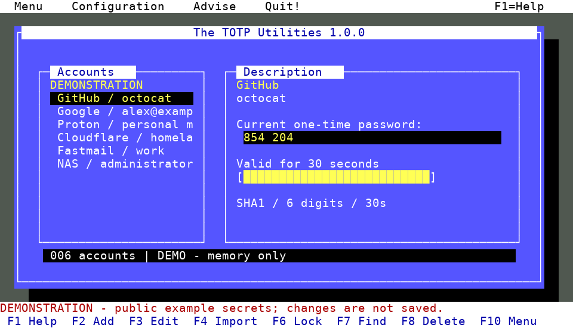

# mytotp

一个带有 Norton Utilities 复古风格界面的离线 TOTP 验证器，程序命令为 `dostotp`。在终端中管理两步验证账号、查看动态验证码，并使用主密码加密保存账号密钥。



## 安装与启动

需要 C 编译器、Make、OpenSSL 开发库，建议同时安装 `pkg-config`。运行时需要支持 UTF-8、ANSI 光标和颜色控制的交互式终端，窗口至少为 **76 列 × 24 行**。

以 Debian / Ubuntu 为例，安装编译依赖：

```sh
sudo apt install build-essential pkg-config libssl-dev
```

在项目目录编译，然后启动演示模式：

```sh
make
./dostotp --demo
```

演示模式自带示例账号，无需设置主密码，所有修改只保留在本次运行中。按 `Q` 退出。

可以直接运行项目目录中的 `./dostotp`，也可以安装到当前用户目录：

```sh
make install PREFIX="$HOME/.local"
```

将 `$HOME/.local/bin` 加入 `PATH` 后，即可使用 `dostotp` 命令。下文使用项目目录中的 `./dostotp` 举例。

## 第一次使用

```sh
./dostotp
```

1. 首次启动会显示 `Create encrypted vault`，要求创建加密账号库。
2. 输入主密码，按 `Tab` 切换到 `Repeat password`，再次输入，按 `Enter` 确认。密码至少需要 8 字节；使用英文字符时即至少 8 个字符。
3. 按 `F2` 或 `A` 手动添加账号，或按 `F4` 或 `I` 导入账号链接。
4. 用方向键选择账号，右侧会显示当前验证码及剩余有效时间。在对应网站或应用中输入验证码。
5. 按 `Q` 退出。下次启动时，输入主密码即可解锁。

新增、编辑、导入和删除账号后会自动保存，无需另行执行保存操作。出现 `Changes saved` 表示保存成功；如果提示保存失败，本次修改会被放弃。

**主密码无法找回。** 请妥善保存主密码，以及各网站提供的两步验证恢复码。

## 添加与导入账号

### 手动添加

在网站或应用的两步验证设置中取得手动设置密钥，按 `F2` / `A` 打开表单：

| 字段 | 填写内容 |
| --- | --- |
| `Issuer` | 服务名称，例如 `GitHub`，可留空 |
| `Account` | 用于区分账号的名称，例如邮箱地址，必填 |
| `Base32 secret` | 服务提供的 Base32 密钥，输入时以星号显示 |
| `Algorithm` | `SHA1`、`SHA256` 或 `SHA512`，默认 `SHA1` |
| `Digits` | 验证码位数，支持 `6` 或 `8`，默认 `6` |
| `Period (sec)` | 刷新周期，支持 1–300 秒，默认 `30` |

算法、位数和周期应与服务提供的设置一致。Base32 密钥不区分大小写，允许包含空格和连字符。服务名称和账号名称不能包含冒号 `:`，同一账号库中不能出现服务名称与账号名称均相同的重复条目。每个账号库最多保存 256 个账号。

表单中按 `Tab` / `Shift+Tab` 切换字段，按 `Ctrl+U` 清空当前字段，按 `Enter` 提交整个表单，按 `Esc` 取消。

### 导入账号链接

按 `F4` / `I`，使用终端的粘贴功能填入完整的 `otpauth://totp/` 链接，再按 `Enter`。链接输入时会被遮蔽。

以下链接仅供演示，请勿用于真实账号：

```text
otpauth://totp/Example:alice%40example.com?secret=JBSWY3DPEHPK3PXP&issuer=Example&algorithm=SHA1&digits=6&period=30
```

当前支持单个 TOTP 链接导入，不支持 HOTP、直接扫描二维码或导入二维码图片。如果服务只显示二维码，请查找其“手动输入密钥”选项，或使用可信的本地工具读取二维码中的 TOTP 链接。

## 日常操作与快捷键

以下快捷键用于主界面。如果终端拦截了功能键，可以使用对应的字母键。

| 操作 | 按键 |
| --- | --- |
| 选择上一个 / 下一个账号 | `↑` / `↓`，或 `K` / `J` |
| 跳到首个 / 末尾账号 | `Home` / `End` |
| 翻页 | `Page Up` / `Page Down` |
| 查看帮助 | `F1`、`H` 或 `?` |
| 添加账号 | `F2` 或 `A` |
| 编辑所选账号 | `F3`、`E` 或 `Enter` |
| 导入 TOTP 链接 | `F4` 或 `I` |
| 显示所选账号的配置链接 | `F5` 或 `R` |
| 锁定账号库 | `F6` 或 `L` |
| 按服务名称或账号名称查找 | `F7` 或 `/` |
| 清除查找筛选 | `Esc` |
| 删除所选账号 | `F8`、`D` 或 `Delete` |
| 打开设置 | `F9` 或 `S` |
| 打开主菜单 | `F10` 或 `M` |
| 隐藏 / 显示验证码 | `Space` |
| 退出程序 | `Q` |

删除账号需要按 `Y` 确认，按 `N` 或 `Esc` 取消。删除操作只移除本地记录，不会关闭对应网站的两步验证；重新添加需要原始密钥或备份。

如需将单个账号转移到其他验证器，选中账号后按 `F5` / `R`，按 `Y` 确认显示配置链接，再使用终端的文本选择功能复制。链接包含可重复使用的账号密钥，获得它的人也能生成验证码，请勿公开或分享。复制折行显示的长链接时，应去掉额外的换行和界面边框。

## 锁定与设置

默认在 **300 秒无操作后自动锁定**，也可以按 `F6` / `L` 立即锁定。重新输入主密码即可继续使用；在解锁界面按 `Esc` 会退出程序。

按 `F9` / `S` 打开 `Configuration`，然后按对应数字：

| 选项 | 用途 |
| --- | --- |
| `1 Change master password` | 输入当前密码和两次新密码，更改账号库的主密码 |
| `2 Auto-lock timeout` | 设置自动锁定时间，范围为 0–86400 秒，`0` 表示关闭 |
| `3 Vault information` | 查看账号库路径、账号数量及当前锁定时间 |
| `4 Switch color palette` | 切换默认配色与终端标准 16 色配色 |

锁定时间和配色的修改只影响本次运行。需要在下次启动时使用相同设置，可以传入命令行参数：

```sh
./dostotp --timeout 60 --ansi
```

## 账号库位置与启动参数

默认账号库位置：

- 若 `XDG_DATA_HOME` 已设置为绝对路径：`$XDG_DATA_HOME/dostotp/accounts.vault`。
- 否则：`$HOME/.local/share/dostotp/accounts.vault`。

默认目录会自动创建。也可以使用 `--vault` 管理独立的账号库，例如区分个人账号与工作账号：

```sh
mkdir -p "$HOME/totp-vaults"
./dostotp --vault "$HOME/totp-vaults/work.vault"
```

指定的文件不存在时会引导创建账号库；使用自定义路径前，需要先创建父目录。账号库必须是普通文件，不能是符号链接。

| 参数 | 说明 |
| --- | --- |
| `--vault PATH` | 打开或创建指定路径的加密账号库 |
| `--demo` | 进入演示模式，不读取或保存账号库 |
| `--ansi` | 使用终端标准 16 色配色 |
| `--timeout SECONDS` | 无操作后的锁定时间，默认 `300`，范围 0–86400 秒，`0` 关闭自动锁定 |
| `--help` / `-h` | 显示命令行帮助 |
| `--version` | 显示版本号 |

## 备份与恢复

账号数据以加密形式保存在 `.vault` 文件中。备份时退出程序，复制正在使用的账号库文件即可；旁边的 `.lock` 文件无需备份。

例如，使用默认路径且未设置 `XDG_DATA_HOME` 时：

```sh
mkdir -p "$HOME/totp-backups"
cp "$HOME/.local/share/dostotp/accounts.vault" "$HOME/totp-backups/accounts-backup.vault"
```

如果设置了 `XDG_DATA_HOME` 或使用了 `--vault`，请将源路径换成实际账号库路径。备份文件应保存在可靠的位置，需要跨设备恢复时也应保留设备之外的副本。

恢复时，将备份复制到一个可写目录，再使用 `--vault` 打开副本：

```sh
mkdir -p "$HOME/totp-restored"
cp "$HOME/totp-backups/accounts-backup.vault" "$HOME/totp-restored/accounts.vault"
./dostotp --vault "$HOME/totp-restored/accounts.vault"
```

输入备份生成时使用的主密码，即可继续使用其中的账号。后续修改会保存到这个恢复副本。**更改当前账号库的主密码不会更改已有备份的密码**，请在改密后重新备份。

## 常见问题

**验证码被网站拒绝怎么办？**

先确认选中了正确账号，并检查系统时间是否准确、时间同步是否正常。随后核对密钥、算法、验证码位数及周期是否与服务要求一致。验证码快到期时，可等待下一组验证码再输入。

**界面显示 `Resize terminal`，或颜色、字符显示异常？**

将终端扩大到至少 76 列 × 24 行，使用 UTF-8 编码和支持相应字符的字体。颜色显示异常时尝试 `./dostotp --ansi`。程序需要交互式终端，不能通过管道或重定向运行界面。

**提示账号库已被其他进程打开？**

同一账号库一次只能由一个程序实例打开，请退出正在使用它的实例。`.lock` 文件在退出后保留是正常现象，不需要手动删除。

**使用 `--vault` 后提示无法打开锁文件？**

检查指定路径的父目录是否存在，以及当前用户是否有写入权限。程序需要在账号库旁创建锁文件，并在保存时写入临时文件。

**忘记主密码，或出现 `Wrong password or damaged vault`？**

先确认打开的是正确文件，并使用与该文件对应的密码；旧备份可能仍使用旧密码。程序没有密码重置或恢复功能。如果文件损坏，尝试完好的备份；如果无法解锁，则需要使用对应服务的恢复码或账号恢复流程。

加密文件的详细格式见 [账号库格式说明](docs/vault-format.md)。

## 许可证

本项目采用 [MIT License](LICENSE)。
